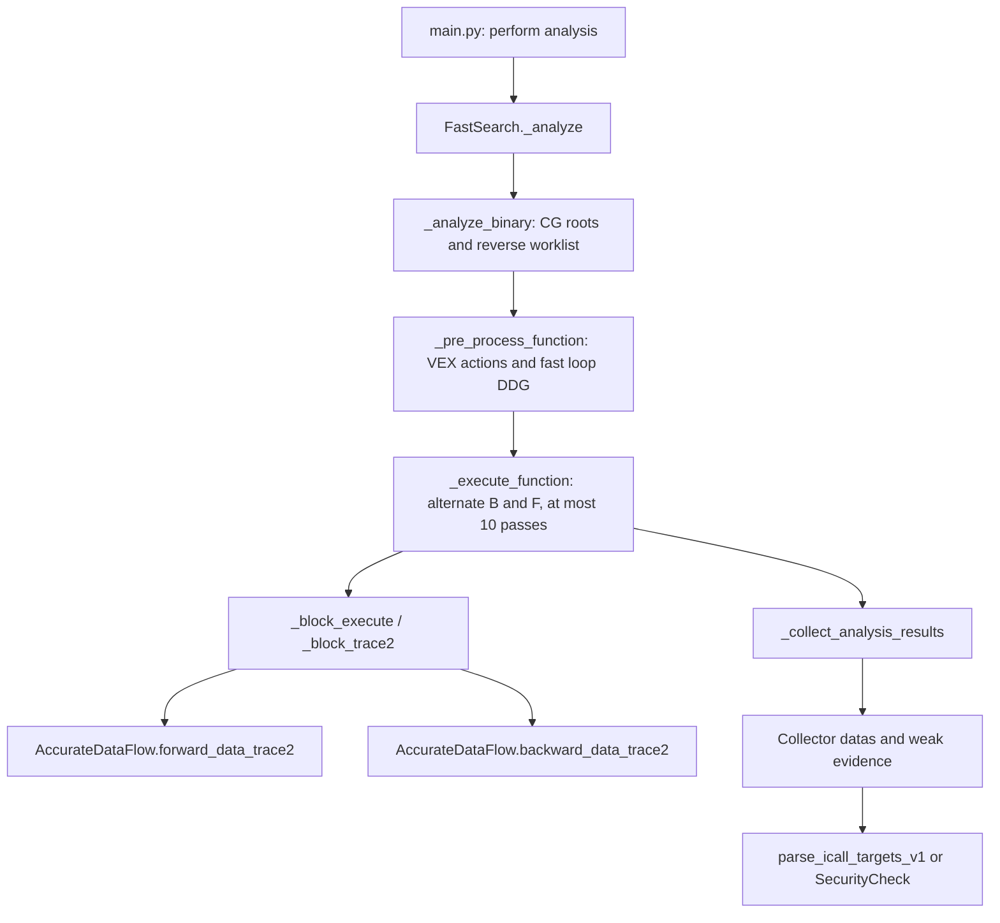

# R1-A — Legacy EmTaint dataflow overview

Status: **research, awaiting owner review**. Source of truth is the local `references/legacy-emtaint` snapshot, not an online repository. `D:/works/dataflow/EmTaint/emtaint-migration/EmTaint` is a separate runnable migration checkout (HEAD `72a9e3081632b2f9d1881141bc7b0d43c7158033`); it is not evidence that the reference snapshot runs. No legacy analysis was executed. The complete 164-file, local-byte SHA256 inventory and containing-repository commit are in [LEGACY_DATAFLOW_SNAPSHOT.md](LEGACY_DATAFLOW_SNAPSHOT.md). The original EmTaint commit of copied bytes is unknown.

## Module map

| Layer | Files and responsibilities | Evidence |
|---|---|---|
| Program entry and orchestration | `main.py` constructs `FastDataFlow`, `AccurateDataFlow` and `FastSearch`; `data_trace.py:FastSearch` traverses call graph and function CFG, alternates forward/backward expression propagation, and collects results. | `main.py:550-585`; `data_trace.py:337-481,484-567` |
| Binary/IDA acquisition | `ida_plugin/*` exports IDA-derived blocks, functions, calls and bytes; `ida_process.py`, `data_process.py:DataParser`, `binary_info.py` and `parse_binary.py` load and normalize VEX/IDA information. `ast_data_parser.py`, `parse_ast.py`, `translate_vex.py`, `vex_process.py`, `irop.py`, `vex/*` support IR translation/parsing. These are input/environment integration, not a standalone alias engine. | `data_process.py:77-225,266-414`; `parse_binary.py:1295-1602`; `data_trace.py:640-700` |
| Graphs and state | `generate_cfg.py`, `cfg_base.py`, `cfg_node.py`, `block_node.py`, `function_object.py`, `call_graph.py`, `call_context.py`, `graph_method.py`, `loopfinder.py`, `code_location.py` represent CFG/CG, block expression queues, live definitions, loops and context. | `call_graph.py:39-145`; `data_trace.py:360-395,3549-3614` |
| Transfer engines and expressions | `fast_data_flow.py` builds backward use/definition links and loop increment hints; `accurate_data_flow.py` handles VEX actions, expression substitution, Store/Load, register, guard and taint rules. `variable_expression.py` defines `Sim`, `SimAction`, `VarExpr`, `TraceExpr`, `RecursiveExpr`; `merge_expressions.py` helps expression combination. | `fast_data_flow.py:102-321`; `accurate_data_flow.py:2581-2847`; `variable_expression.py:16-146,872-1190` |
| Procedure/security policy | `sim_procedure.py` and `procedures/*` model library calls and source/return propagation; `taint_source_config.py`, `security_check.py` select sources and assess weak copies/command execution. `procedures/stubs/*` includes format parsing. | `sim_procedure.py:108-174,545-702,1167-1254`; `security_check.py:33-85` |
| Other support | `global_config.py`, `variable_type.py`, `errors.py`, `__init__.py` hold configuration, type labels and packaging. `.bak` procedure files are historical reference only. | Complete paths/hashes in snapshot manifest |

## Actual top-level chain

The two modes share transfer mechanics but select different seeds and collectors. `FastSearch._analyze` chooses iCall, switch or taint mode (`data_trace.py:337-358`). `_analyze_binary` chooses roots, skips previously analyzed functions, and seeds only matching function data/source/sink paths (`data_trace.py:360-481`). `_execute_function` chooses B→F or F→B from `execute_flag`, bounds passes at ten and collects outputs (`data_trace.py:484-567`). Within a block, `_block_trace2` alternates `AccurateDataFlow` transfer and pushes the surviving expressions to predecessors/successors (`data_trace.py:5154-5188,5097-5116`). This is an operational bound, not a proof of convergence.

`TraceExpr` contains a mutable symbolic AST, path, source/taint identity, constraints and location index; `VarExpr` holds `sims` and `sim_actions`. `SimAction` records load/store actions and address-like binop matching (`variable_expression.py:40-146,146-246,872-1190`). These objects carry runtime Claripy/VEX state and are unsuitable as public serialized CIR contracts. There is no evidence that the snapshot's mutable expression lists and hash identities are stable across acquisitions.

## Reference boundaries

The snapshot is read-only algorithm evidence; no Python import, execution or package dependency is proposed. The runnable migration checkout can later support separate, owner-authorized behavioral comparison, but this R1-A review uses static source inspection only. The reference's IDA exports and procedures are environment/policy inputs; neither proves a frontend-independent algorithm. Detailed rule and call-chain audit is in `LEGACY_DATAFLOW_ALGORITHM_AUDIT.md`.
