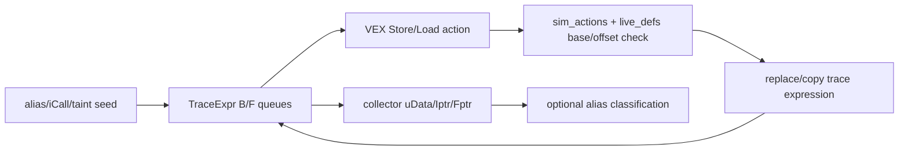
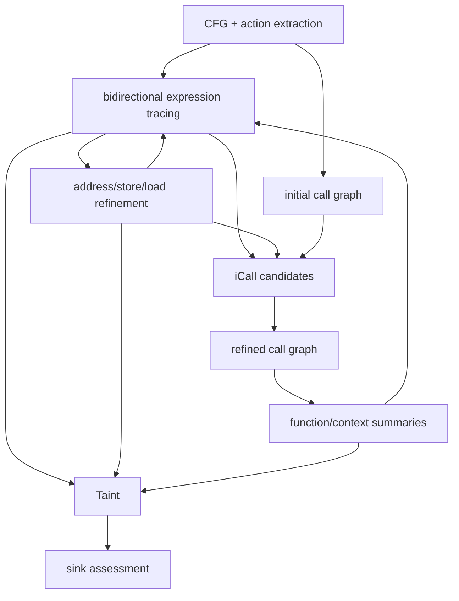

# R1-A — Legacy dataflow algorithm audit

Research scope: static source audit of local `references/legacy-emtaint` as tracked in BinaryAnalysis HEAD `2176e78f7cc410838603912886b35be7cf39c5d1` (the original EmTaint commit is unknown). Task/approval status remains in root `BACKLOG.md` and `EXECUTION_PLAN.md`. Paths/lines below refer to that snapshot. “Implemented” means a reachable source path was found, not soundness or runtime verification. The runnable `emtaint-migration/EmTaint` checkout was identified as a separate code lineage; no legacy or new analysis was run.

## 1. Alias: query seeds, address refinement and limits

**Entry and state.** The special alias-source path is conditional on the global `alias_check` and names `NOALIAS/MAYALIAS/MUSTALIAS`, then calls `_initialize_alias_check` → `DataParser.inital_alias_check_variables` → `_execute_function` (`data_trace.py:441-444,734-745`; `data_process.py:354-388`). Ordinary iCall/taint analysis also triggers Store/Load alias substitutions while processing seeded expressions: `_block_trace2` → `AccurateDataFlow.forward_data_trace2` / `backward_data_trace2` → action handlers (`data_trace.py:5154-5188`; `accurate_data_flow.py:2581-2847`). `Collector.alias_check` groups collected `uData` by `alias_id`/`contain_alias` and prints a comparison (`data_collector.py:82-115`), but the call in `main.py:566` is commented. The regular main path does **not** produce a reliable public AliasQuery result from that function.

**Transfer.** An action uses `dst_alias`/`src_alias` when available, otherwise raw address/value. Forward Store checks pointer-sized values and source symbols, creates `Store`-based aliases/argument-pointer definitions (`accurate_data_flow.py:1901-1985`). Backward Store checks statement index, pattern, address kind, width, `sim_actions` and `_do_store_define`; it can generate aliases from a stored symbol (`accurate_data_flow.py:3335-3399`). Backward Load expands a concrete address or base+offset/variable when it intersects expression symbols (`accurate_data_flow.py:3525-3580`). `SimAction.re_store_def`, `load_use`, `get_binop_alias` compare symbolic base/offset forms (`variable_expression.py:70-145`). Substitution of a recovered store address uses `TraceExpr.replace` and marks forward direction (`accurate_data_flow.py:155-165`). Stack/register cases depend on VEX action and `live_defs`; global pointer cases rely on concrete addresses and collector lookup. Exact byte ranges, object lifetime, address-space tags and complete separation evidence are not present in this path.

**Assessment.** The engine has **demand seeded expression refinement** during selected analyses, not a general lazy, sound `AliasQuery` service. `Collector.alias_check` reports `NOALIAS` when either side has no collected data (`data_collector.py:99-115`); absence of evidence cannot justify NoAlias. Source has several empty or inactive variants (`accurate_data_flow.py:1399-1403`; `data_trace.py:1023-1025`). Partial offset matches and inferred pointer types are heuristics, not MustAlias proof. Preserve may/unknown under unresolved base, offset, path, width or budget.

## 2. Bidirectional SSE-like expression propagation

**Actual chain.** `main.py:550-562` constructs engines and `FastSearch`. `_analyze_binary` builds a reverse call-graph worklist and only enters selected functions (`data_trace.py:360-481`). `_pre_process_function_vex` creates action/live-definition material and uses `FastDataFlow.execute_loop` for loop DDG hints (`data_trace.py:640-700`; `fast_data_flow.py:102-321`). `_execute_function` alternates function-level backward and forward passes with a ten-pass cap (`data_trace.py:515-556`). `_backward_data_flow_analysis` walks CFG presequence in reverse; `_forward_data_flow_analysis` walks it forward; loops use dedicated processors and clear expression queues (`data_trace.py:3549-3614`). `_block_execute` calls `_block_trace2`; that alternates statement-level `forward_data_trace2` and `backward_data_trace2`, then pushes live expressions to neighboring blocks (`data_trace.py:5010-5116,5154-5188`). Forward traverses `code_locations` in order; backward traverses in reverse and uses register-definition pre-update (`accurate_data_flow.py:2628-2683,2716-2767`). `VarExpr.replace` changes AST/sims/sim_actions; `TraceExpr.deep_copy`, `merge_state` and path/index fields govern lifecycle (`variable_expression.py:146-267,872-1190`).

**Rules.** Forward dispatch handles Store, Put, WrTmp, LoadG and related action kinds (`accurate_data_flow.py:1901-2416,2581-2627`); backward dispatch handles Store, Put, binop, Load, LoadG and ITE (`accurate_data_flow.py:2804-2847,3335-3658`). Kill/redefinition is action- and index-dependent, including `_kill_exprs`, `_backward_check_store_def`, `kill_expr_by_reg_redefine` (`accurate_data_flow.py:3268-3399`; `data_trace.py:5556-5575`). Store/Load substitutions use symbolic `sim_actions` and cached `live_defs`, with weak evidence for partial overlap. Branch constraints and loop cycle locations influence propagation (`data_trace.py:5190-5225,5700-5745`; `accurate_data_flow.py:2765-2771`). At CFG edges, reverse/forward path membership suppresses some paths, and duplicate detection compares `ast_iid` in taint mode or expression equality in iCall mode before `merge_state` (`data_trace.py:5711-5745`).

**Limits.** Mutable copies, AST replacement, path combinations and per-callee context substitution can multiply expressions. The ten-pass function cap and loop clearing bound work but do not establish a fixed point. Unsupported action kinds return an empty new-expression list (`accurate_data_flow.py:2831-2836`), which is not an explicit partial semantic result. No evidence establishes that both queues are synchronized for every action/overlap, so the new architecture must specify forward/backward query consistency rather than inherit the lists.

## 3. Indirect calls

**Reachable chain.** IDA-derived iCall locations and pointer records enter `DataParser.pre_process_function_data` (`data_process.py:77-225,279-310`), then `FastSearch._analyze_binary` seeds matching functions (`data_trace.py:448-465`). VEX preprocessing and `AccurateDataFlow` B/F tracing collect `Iptr`, `Fptr`, `Vptr` and constraints (`data_trace.py:1130-1250,2353-2411`). `FastSearch._analyze` calls `Collector.parse_icall_targets_v1` after tracing (`data_trace.py:337-346`). That builds a Store index from Vptr/Fptr; replaces concrete pointer aliases and Loads; evaluates constants, concrete memory Loads and bounded indexed tables (`data_collector.py:363-446,448-468,575-623`). `maybe_function`/`is_code_region` and external-name lookup filter/label targets, then `add_icall_target` stores them (`data_collector.py:398-446`). `main.py:71-76` saves this collection as iCall JSON. Call-graph construction uses separate IDA/CFG paths; this collector result alone is not a versioned Refined CG proof.

**Coverage and limits.** Constant function values, a concrete global Load and bounded indexed tables are represented. Stores and symbolic register/stack propagation can feed `Iptr`, but matching still depends on recovered AST, action support and address heuristics. `parse_function_ptr` is commented in `data_trace.py:345-346`; its `_find_symbol_icall_target` is `pass` (`data_collector.py:117-173`). `guess_icall_targets` replaces unresolved `o` symbols with zero before retrying (`data_collector.py:637-658`), so any such target is speculative. `parse_icall_targets_v1` contains a hard-coded source-address branch (`data_collector.py:395-396`). A recovered target is a **candidate**, not a confirmed call edge. Unresolved, ambiguous and invalid-address cases need explicit new result states; the old collector does not provide them as a typed contract.

## 4. Taint and interprocedural summaries

**Reachable chain.** Taint mode in `FastSearch._analyze` reconstructs CFG and traverses roots (`data_trace.py:352-355,360-481`). `_get_taint_sources` checks graph successors for configured library source names (`data_trace.py:423,6966-6977`). Selected functions undergo the B/F engine. At callsites `_block_execute` runs procedure models for forward and sometimes backward flow (`data_trace.py:5010-5055`); source models such as `procedures/libc/read.py:run` call `SimProcedure.initial_arguments_taint_source`, and `procedures/libc/getenv.py:run` calls `initial_ret_taint_source` (`sim_procedure.py:1167-1281`). Source, return, argument-pointer and global expressions are collected/updated through function/callsite state (`data_trace.py:1209-1342,3677-3912,4174-4684,5886-5990`). `_push_forward_exprs_to_succ_block` collects weak sink candidates (`data_trace.py:5190-5221`). `SecurityCheck.check_taint_security` filters sources and evaluates copy/command candidates with constraints (`security_check.py:33-85,149-185`). This is heuristic vulnerability assessment, not binary-confirmed proof.

**Demand classification.** The entry scans call-graph roots, selects functions containing source calls and propagates through functions; it is chiefly **source-driven with function-level selection**. User sink/search paths are optional (`data_trace.py:451-472`). There are backward expression transfers, but no evidence here of a general sink-originated taint query API. `data_trace.py:_initialize_taint_source` is defined at 6979 but has no callsite in this snapshot; it calls `data_parser.inital_source_arguments`, while `inital_source_arguments` is a module-level function in `data_process.py:414`. It is a dead/inconsistent path, not evidence of working source initialization. `function_analyzed_times`, `analyzed_functions`, expression equality and path IDs suppress repeated work (`data_trace.py:401-414,484-489,5711-5745`); the cap and pruning can lose precision. Procedure models are behavior summaries but are mutable/context-dependent, not immutable versioned function summaries. Global taint is copied into block expressions and killed on global definitions (`data_trace.py:5160-5161,5123-5125`). The legacy code lacks explicit partial-result semantics for unresolved callee, unsupported action, exceeded bound and uncertain sink guard.

## 5. Dependency and research conclusions

Open questions for a later owner-approved implementation slice: exact alias classification against partial byte overlap; memory-version reconciliation across call contexts; versioned CG/summary fixpoint and invalidation; target validation with address-space conversion; loop widening/budget reporting; representative CTree/VEX differential evidence. The static audit cannot establish runtime recovery rate, performance, false-positive rate or semantic equivalence with the runnable migration checkout.

## 6. Caller/state/termination ledger

| Algorithm | Caller → callee | Input state → output state; condition/stop |
|---|---|---|
| Alias | `FastSearch._block_trace2` → `AccurateDataFlow.forward_data_trace2`/`backward_data_trace2` → Store/Load handlers → `VarExpr.replace` | Seeded B/F `TraceExpr`, VEX `Action`, `live_defs` → substituted/copy expression and `sim_actions`; only matched symbol/address/pattern branches produce additions. Block loop stops when no new forward expression (`data_trace.py:5167-5188`). `Collector.alias_check` is a separate inactive report path. Its `_is_alias` compares AST hash sets, not proved locations (`data_collector.py:54-70`). |
| SSE | `FastSearch._execute_function` → `_backward_data_flow_analysis`/`_forward_data_flow_analysis` → `_block_execute` → `_block_trace2` → `AccurateDataFlow` dispatch | Function CFG, block queues, path/constraint state → adjacent-block queues and collected expressions. Function pass stops on trace flags or ten passes (`data_trace.py:515-556`); block alternation stops when no forward expression (`data_trace.py:5183-5188`); duplicate/path suppression at `data_trace.py:5711-5745`. |
| iCall | `FastSearch._analyze` → `_analyze_binary`/`_execute_function` → `_collect_analysis_results` → `Collector.parse_icall_targets_v1` → `replace_load_value`/`calculate_icall_targets` → `add_icall_target` | IDA iCall/Store seeds and traced `Iptr`/`Fptr`/`Vptr` → per-function target set. Bounded `Max_i` enumeration stops on unreadable/nonfunction/end values (`data_collector.py:575-623`); no target may trigger zero-substitution guess (`data_collector.py:402-403,637-658`). |
| Taint | `FastSearch._analyze` → `_analyze_binary` → `_execute_function` → `_block_execute` → procedure `run`/`SimProcedure.initial_*_taint_source` → propagation → `Collector.collect_weaks` → `SecurityCheck.check_taint_security` (from `main.py:585-586`) | Source-call-bearing function and procedure source seed → B/F taint expressions, callsite/global propagation and weak candidate. Function traversal skips analyzed function/address and bounds passes; security heuristics filter/score after propagation. Unknown callee/budget does not have a typed partial result in the snapshot. |
